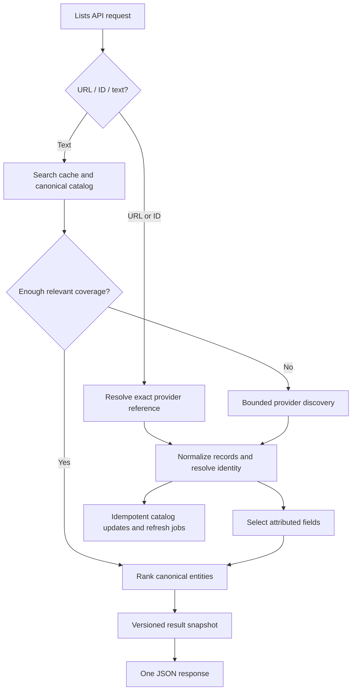

# Lists metadata engine: architecture review and implementation plan

Reviewed 7 November 2026. Scope: repository architecture, representative provider implementations, Android/Web integration, local correctness probes, and current official source documentation. This is an implementation plan; production behavior has not been changed. Live authenticated provider coverage, deployed latency, traffic, and operating costs have not been measured.

Implementation update: request-time aggregation, book integration, base-game filtering, a bounded optional D1 catalog, and lean device snapshots have been built. Current behavior and limits are documented in [server/README.md](server/README.md). The active scope is search and multi-list tracking; recommendation development is explicitly deferred and recommendation calculations are removed from normal search. Findings below describe the original reviewed version; future recommendation sections are historical planning, not active implementation commitments.

## 1. Recommendation

Keep TypeScript, Hono, Cloudflare Workers, and useful provider adapters. Rebuild the identity model, matching/merging pipeline, orchestration, and cache/error contracts behind a versioned API. Bring the separate book engine's useful ISBN and edition handling into that service. Gradually reduce Android and Web to API clients with offline storage.

The central asset should be a persistent catalog of canonical entities, provider identifiers, relationships, and attributed metadata. Search should primarily retrieve those entities, with bounded provider discovery for missing coverage. Enrich selected entities using identifiers. Each successful resolution should improve subsequent searches.

Speed, coverage, and correctness compete when an external source is slow or ambiguous. Set measurable targets, return honest partial results, and optimize from evidence. There is no reliable guarantee of perfect results or sub-50 ms live aggregation across independent upstreams.

Default product behavior: one result per work at the chosen granularity, with editions/releases nested or selectable. Separate a movie from its novel, a remake from its original, and a game from its DLC. Display a book's particular edition when the user imports its ISBN. Cross-media adaptations are related entities.

## 2. Current architecture and verified problems

Current path:

```text
Android / Web
  -> client normalization, cache, URL handling
  -> universal Worker /v1/search
       -> isolate memory cache
       -> await all first-tier providers
       -> if raw count < 5, await all second-tier providers
       -> title/year deduplication -> heuristic field merge -> ranking
  -> client validation and another deduplication pass
  -> embedded providers when remote returns empty, fails, or times out

Separate book Worker -> independent ISBN, search, merge, recommendations
```

| Priority | Evidence in repository | Effect | Required change |
| --- | --- | --- | --- |
| P0 | `server/src/types.ts`: no provider ID, canonical ID, aliases, ISBN, provenance, or entity granularity | Cannot reliably connect records or correct merges | Introduce provider records and canonical entities before adding sources |
| P0 | `merger/entityMerger.ts`: key = stripped ASCII title + exact year | Missing/different dates split duplicates; same title/year merges unrelated works | Match on IDs first, then evidence with domain rules |
| P0 | `normalizer/canonicalTitle.ts`: removes part, season, volume and everything after its number | Distinct volumes and parts collapse; display titles are altered | Preserve titles; parse relationships into separate fields |
| P0 | Same file: `[^a-z0-9]` key filtering | Native-script titles can disappear | Unicode-preserving normalization and multilingual aliases |
| P0 | `index.ts` awaits entire provider tiers; app remote wrapper uses 2,200 ms | Slow provider delays response; client may begin another provider fan-out | Shared overall deadline, cancellation, selective fallbacks |
| P0 | Provider errors return `[]`; cache stores all-empty outcomes for ten minutes | Outages become authoritative absence | Typed outcomes and failure-aware caching |
| P0 | `index.ts` enrichment emits Apple/Prime/Netflix search links after a JustWatch search match | Generic search links look like verified availability | Return verified regional offers or explicitly labeled search links |
| P0 | `/v1/enrich` re-searches a title and takes a match | Wrong remake/show/edition can receive metadata or episodes | Enrich by canonical/provider ID |
| P1 | Fallback gate counts raw records before validation/merge/relevance | Many duplicates or irrelevant hits suppress a better source | Evaluate unique relevant entities and missing fields |
| P1 | TMDB is second-tier for movies; IGDB IDs and external links are discarded | Strong structured sources underused | Make authoritative catalog providers primary where eligible |
| P1 | Server parses `subFilter` but uses it only in logging/cache; no `bookSearchType` handling | UI choices do not reliably reach remote search | Explicit documented filter and search-mode contract |
| P1 | `lang` inconsistently forwarded; Open Library argument unused; several providers force English/US | Locale options do not represent actual behavior | Separate UI language, content language, country, and strict language filtering |
| P1 | Normalizer removes the first 19xx/20xx token; computed Roman variants unused by server | Titles containing years break; advertised query expansion ineffective | Preserve original query and use bounded alternate interpretations |
| P1 | Steam adapter puts a price in `creator`, supplies no overview/year; both clients reject sparse Steam results | Useful Steam results disappear; identity joins fail | Separate pricing, preserve App ID, fetch selected-item details |
| P1 | Manga chapters and comic issue counts occupy `totalPages` | Invalid tracking totals | Distinct typed counts and scope |
| P1 | Some providers fill absent release dates/years from the query's year | User input becomes alleged source fact | Unknown stays null; filter constraints are separate |
| P1 | `cacheManager.ts`: only module Maps, negative map unbounded | Cache evaporates on isolate replacement; no distributed coalescing | Bounded local cache plus durable catalog/shared cache |
| P1 | Merger chooses longer descriptions, first nonzero ratings, and cover URL strings | Provider order controls truth; longer text may concern wrong edition | Attributed per-field policy and conflict handling |
| P1 | Google/Open Library book results relabeled as board games | Guides/rulebooks pollute game results | Remove these adapters from board-game discovery |
| P1 | Cataloggd assumes IDs map directly to comics.org | Incorrect outgoing entity link is possible | Verify provider identity namespace; never fabricate crosswalks |
| P1 | Android/Web retain parallel search engines and re-merge server results | Divergent behavior, repeated requests, maintenance duplication | Centralize correctness and preserve only client presentation/offline logic |
| P2 | Ranking recalculates fuzzy scores inside sort; no minimum relevance threshold | Repeated CPU work and irrelevant tail results | Compute features once; evaluate ranker on labels |
| P2 | `/health` advertises six providers/category regardless of configuration; README promises <50 ms | Misleading operational expectations | Report enabled capabilities and actual measured latency |
| P2 | Package `start` runs a Worker entry with no Node listener; build has `noEmit` | Documented Docker alternative is not a working Node deployment | Support an explicit Node adapter later or remove that deployment claim |

Local probes against existing code produced:

| Input / condition | Observed output |
| --- | --- |
| `Example Volume 1` and `Example Volume 2`, same year | One result titled `Example` |
| `Home`, same year, two different authors | One result retaining the first author |
| `Dune` with year 1965 and without a year | Two results |
| Japanese-only title `進撃の巨人` | No results after merge |
| `2001: A Space Odyssey` | Clean query `: A Space Odyssey`, extracted year 2001 |
| Mock every upstream request to throw | HTTP 200 empty results, then an empty cache hit |
| `category=INVALID` | HTTP 200 empty results instead of validation error |

`npm run build` in `server/` passes. These are deterministic local probes, not a production benchmark. Existing application and book-provider edits were present at the start of review and have been left untouched.

## 3. Canonical data model

Store a provider record separately from the canonical entity it describes. A normalized search card is a projection, not the database model.

Core records:

```ts
type EntityKind =
  | 'movie' | 'tv_series' | 'tv_season' | 'tv_episode'
  | 'book_work' | 'book_edition'
  | 'manga_series' | 'comic_series' | 'comic_issue' | 'comic_collection'
  | 'game' | 'game_release' | 'game_dlc' | 'board_game' | 'board_game_edition';

interface SourceRecord {
  source: string;
  sourceId: string;
  kind: EntityKind;
  sourceUrl: string;
  fetchedAt: string;
  payloadHash: string;
  adapterVersion: string;
  // Validated, source-specific typed data retained under permitted retention rules.
}

interface FieldEvidence<T> {
  value: T;
  sourceRecordId: string;
  observedAt: string;
  locale?: string;
  scopeEntityId: string;
  method: 'api' | 'structured_page' | 'manual';
}

interface CanonicalEntity {
  id: string;                  // Opaque stable ID; never title-derived.
  kind: EntityKind;
  mediaType: 'movie' | 'tv' | 'book' | 'manga' | 'comic' | 'game' | 'board_game';
  facets: string[];            // e.g. anime; independent of identity.
  titles: Array<{ text: string; language?: string; role: string }>;
  providerRefs: Array<{ source: string; sourceId: string }>;
  version: number;
  // Roles, scoped dates, artwork, relationships and domain-specific attributes.
}
```

Use a discriminated union for domain attributes. Books need ISBNs, work/edition links, authors, translators, publisher, format, language, publication date and pages. Games need release variants, platforms, developer/publisher roles, game type and external storefront IDs. TV needs series/season/episode relationships and airing status. Manga needs chapters and volumes separately; comics need issue designation, series and collection membership. Board games need designers, player range, playtime and edition/expansion relationships.

Anime is a discovery facet of animated movies/series. A title retrieved through both TV and anime search can share one canonical entity after verified crosswalking. Manga and its animated adaptation remain separate. Different providers sometimes divide seasons differently: preserve provider scope and map season/part relationships instead of flattening them.

Dates carry precision (`year`, `month`, `day`), role (original publication, edition publication, regional release) and country where known. Unknown values are null. Counts record whether they are announced, released, or estimated. A median page count is explicitly an estimate; a selected edition's page count belongs to that edition.

Ratings remain a collection of `{source, value, scale, count, observedAt}`. A UI may choose one or display a normalized value with its source. Never add review counts from potentially overlapping feeds or average heterogeneous ratings without an evaluated policy.

Persist these tables initially:

- `entities`, `entity_titles`, `entity_relationships`, and typed domain attributes.
- `source_records` with uniqueness on `(source, source_id, source_entity_kind)`.
- `entity_source_links` with one active mapping per source record and resolution status.
- `field_evidence` and selected field projections, including policy version.
- `identifier_claims` with namespace, normalized value, source and entity scope. Treat disputed claims as conflicts, not forced merges.
- `entity_redirects`, `merge_events`, and membership history to support merges and splits.
- `refresh_jobs` / transactional outbox with idempotency keys.

Use transactions for entity creation/linking and uniqueness constraints to resolve simultaneous imports. Canonical ID merges retain redirects. Splits record a new mapping and preserve the user's selected entity/edition; do not silently move user history between ambiguous works.

## 4. Entity resolution and metadata merging

Implement matching independently from search relevance. A record can be relevant to a query without being the same entity as another result.

Resolution sequence:

1. Validate the provider record, kind, IDs and field units. Preserve raw titles.
2. Resolve an existing source ID immediately. Normalize ISBN-10/13 with checksum validation and conversion where valid. ISBN identifies an edition, not every edition of a work.
3. Use explicit crosswalks: TMDB/IMDb, TVmaze external IDs, IGDB storefront IDs, documented anime IDs, Open Library work/edition relationships. Verify scope and conflicting IDs before accepting even a claimed exact match.
4. Build a bounded candidate pool using Unicode title/alias similarity, creator IDs/names, kind and relationships. Never compare the entire catalog pairwise.
5. Apply domain-specific match rules. Titles, dates, creators, edition/language, platform, series/issue numbers and runtime are evidence with different strengths.
6. Return `same_entity`, `related_entity`, `different_entity`, or `unresolved`, with reason codes. Auto-merge only calibrated high-confidence matches. Keep ambiguous candidates separate until more evidence or user selection resolves them.
7. Enforce consistency across a whole cluster. Pairwise A≈B and B≈C must not automatically merge incompatible A and C. Matching and field projection must be deterministic across provider arrival order.

Examples of hard conflicts: different verified creator identities for same-title books; different comic issue numbers; base game versus soundtrack; original versus remake; separate known volume IDs. A one-year difference by itself is neither a hard conflict nor proof of identity because regional and edition dates vary.

For sparse records without IDs, matching title alone is insufficient. Favor an occasional visible ambiguous candidate over corrupting a saved user's metadata. Zero duplicate rows is not a valid goal if achieved by hiding different works.

Merge only after identity is established. Select fields with explicit policies:

| Field | Selection rule |
| --- | --- |
| Title | Requested locale, then preferred/original title; preserve aliases and official numbering |
| People/companies | Preserve contributor identity and role; do not substitute cast, network, publisher or price for author/director/developer |
| Description | Correct entity and requested language, then trusted source; sanitize markup and retain alternatives |
| Artwork | Correct work/edition, role, aspect ratio, locale, known dimensions and source reliability |
| Release date | Choose the requested date role/country; retain other release events |
| Pages/chapters/issues | Correct entity scope and unit; never select the maximum as a generic merge rule |
| Episodes | Correct series/season and count definition; refresh ongoing works |
| Ratings | Preserve independent attributed measurements |

Do not judge cover quality from URL length or blindly assume a larger URL variant exists. Deliver small thumbnails for search and larger artwork on detail screens, with provider-specific known variants and fallbacks. Check missing/placeholder artwork asynchronously rather than adding image probes per search result.

## 5. Provider selection

Remove the fixed requirement of six sources per category. Track each provider's unique relevant entities added, useful fields added, verified crosswalks, error rate, latency, quota use, and operational eligibility. Providers earning no incremental benefit should leave the default path.

| Domain | Proposed discovery primary | Targeted secondary/enrichment | Remove or disable from default discovery |
| --- | --- | --- | --- |
| Movies | TMDB | OMDb by IMDb ID for attributed ratings; Apple for storefront metadata/artwork; Wikidata for verified links | Private IMDb suggestions and legacy JustWatch search as core dependencies |
| TV | TMDB, with TVmaze selected according to measured coverage | TVmaze by ID for schedules/episodes; OMDb ratings | iTunes seasons as duplicate series; title-based episode enrichment |
| Books | Open Library + Google Books, within allowed quotas; owned catalog first | Hardcover if its usage terms fit; Apple for storefront/edition coverage; ISBN lookup | Crossref on every general title search; arbitrary Wikipedia matches as primary book records |
| Anime/manga | Select eligible catalog providers after terms review; evaluate Kitsu/Jikan and appropriately scoped TMDB for animation | MangaDex for manga IDs/titles/cover/relationships; permitted crosswalks | AniList default pending explicit eligibility; all-source fan-out |
| Games | IGDB | Steam by App ID; selected Wikipedia/Wikidata links | IMDb as default; CheapShark unless pricing or a missing Steam ID is needed |
| Comics | Comic Vine if approved for the product, or authorized GCD access | ISBN catalogs for collected editions | GetComics posts as canonical catalog records; unverified Cataloggd-to-GCD mappings |
| Board games | BGG with registered application token | Verified Wikidata/Wikipedia entity enrichment | Google/Open Library rulebooks relabeled as games; unverified Board Game Atlas dependency |

These are proposed roles, not claims that every adapter is currently healthy or licensed for redistribution. Provider contract fixtures and authenticated smoke tests are required before promotion. Do not describe Cataloggd as GCD without verifying its actual relationship and ID mapping. Board Game Atlas's present service status was not verified in this review; leave disabled until tested.

Relevant verified source constraints:

- TMDB documents external-ID lookup and multilingual title search. Use those features to avoid repeatedly matching titles. [TMDB finding data](https://developer.themoviedb.org/docs/finding-data)
- TVmaze documents ID lookup and warns that same-title single search can return an undefined match. [TVmaze API](https://www.tvmaze.com/api)
- IGDB documents a four-request/second limit and external-game references. Budget requests centrally for the relevant credential; query minimal fields and batch details. Confirm product usage eligibility before broad caching/ingestion. [IGDB documentation](https://api-docs.igdb.com/)
- Open Library supports work/edition search and identifies one request/second by default, three for identified clients; it directs bulk/high-traffic users to dumps or contact. Do not scale by spreading requests across IPs. [Search](https://openlibrary.org/dev/docs/api/search), [usage guidance](https://openlibrary.org/developers/api)
- AniList's terms restrict competing anime/manga list or tracker services and prohibit mass collection; its rate-limit page also warns of a temporary lower quota. For this Lists product, eligibility must be established explicitly before using it as a primary or retained catalog source. [Terms](https://docs.anilist.co/guide/terms-of-use), [limits](https://docs.anilist.co/guide/rate-limiting)
- BGG now requires application registration and bearer authorization for XML API use. The current adapter sends neither. [BGG API requirements](https://boardgamegeek.com/using_the_xml_api)
- Hardcover offers documented token-based access; validate its current schema, permitted metadata use, retention and rate headers instead of assuming anonymous GraphQL succeeds. [Hardcover API](https://docs.hardcover.app/api/getting-started/)

Store eligibility, permitted fields, caching/retention rules, attribution, and active configuration in the provider registry. This directly determines what the catalog may retain and serve. Keep source-specific projections separable so a source can be removed without losing unrelated facts.

## 6. Goodreads and Steam URL resolution

Use a single backend resolver for typed URLs, identifiers and pasted links. Searching and importing a link should converge to the same canonical entity.

### Goodreads

The existing Android implementation already attempts JSON-LD, including author, pages, rating and description. It is therefore more than a title/cover extractor in code. However, it returns immediately from sparse page metadata and does not run a dependable cross-source enrichment step. Its slug fallback takes the first Google Books result and assigns the Goodreads URL, which can create a false association.

Treat a Goodreads URL as an identity hint and optional metadata input. The `/api` URL redirected to a bot-check homepage during this review; do not build an availability promise on it. [Observed API entry](https://www.goodreads.com/api)

Proposed resolver:

1. Parse the actual host and `/book/show/{id}` path, remove tracking parameters, retain the Goodreads ID and original link. The ID is a Goodreads record ID, not an ISBN or a global work ID.
2. Check existing verified mappings first.
3. Where access is permitted and available, extract bounded JSON-LD `Book` records, `@graph`, arrays, author objects, ISBN, language, publication data, pages and cover. Parse robustly with HTML/JSON parsers rather than a single meta-tag regex.
4. If a valid ISBN exists, resolve its edition through book APIs. Otherwise retrieve candidates using title + author and available edition evidence.
5. Verify identity before attaching fields or asserting a Goodreads crosswalk. Preserve the selected edition's pages, language and publisher. Work-level descriptions may fill missing work data with attribution.
6. If only a URL slug/title is available, show candidate matches or a partial link record. Do not silently take candidate zero. A bare numeric link may remain unresolved.
7. If blocked or unavailable, return `needs_input`/`partial` with any verified facts and allow ISBN, title/author or manual input. No access-check bypass is required for the architecture.

Goodreads community ratings cannot be recreated from Google Books or Open Library. Return their actual source names. A retained Goodreads link does not make other providers' metadata Goodreads metadata.

Acceptance: importing a Goodreads link with an extractable ISBN returns a canonical edition/work relationship and richer available metadata; importing that same work through title search does not create another list entity. A sparse/blocked Goodreads link still produces an honest recoverable result.

### Steam

The server currently calls `storesearch`, which is a lightweight discovery response. There is no Steam-specific selected-item details path. Add:

1. Parse the numeric App ID from supported Steam application URLs. Distinguish apps from packages/bundles and reject unsupported path types explicitly.
2. Resolve the App ID to an existing provider record/canonical game, or find its IGDB external-game mapping. Verify mapping type; an app can be DLC, demo, software or soundtrack.
3. Fetch IGDB details by ID for the game record. Optionally fetch `https://store.steampowered.com/api/appdetails?appids={id}&l={language}&cc={country}` behind an isolated best-effort adapter, with fixture validation, timeout and fallback. Treat this storefront endpoint as less stable than a documented API contract.
4. Retain developer/publisher roles, description, genres, platforms, exact store URL, release status, screenshots and artwork where supplied and permitted. Preserve unknown/coming-soon dates instead of inventing exact dates.
5. Keep region-specific price/currency outside creator fields and outside the canonical identity projection.
6. Join IGDB and Steam search records through the App ID mapping so a missing Steam year no longer creates a second card. Fetch details on selection/import, not for every Steam result on every keystroke.

Valve documents `IStoreService/GetAppList` for paginated and incremental catalog discovery; its older `ISteamApps/GetAppList` is deprecated. This list does not replace rich detail enrichment. Use the current method if catalog ingestion is justified and access is configured. [Store service](https://partner.steamgames.com/doc/webapi/IStoreService), [deprecation](https://partner.steamgames.com/doc/webapi/ISteamApps)

## 7. Search orchestration and ranking



Preserve the original query. Use Unicode NFKC/case folding and whitespace normalization for matching; generate optional diacritic/transliteration aliases without erasing native text. Preserve punctuation/numbers that distinguish works. Parse year interpretations conservatively: explicit filters are authoritative; a standalone/suffix year is only one possible interpretation. Keep `1917`, `1984`, `2001: A Space Odyssey` and `Blade Runner 2049` searchable as titles. Roman numeral conversion is a bounded retrieval alternative, not destructive rewriting of `I`, `V` or `X`.

Search the catalog first. Start with exact identifier/title/alias indexes and full-text retrieval; use prefix and bounded fuzzy candidate generation for misspellings. Fuzzy reranking of upstream results cannot recover a work that no source retrieved. Start at most two eligible live discovery providers on a cold miss. Route by domain, query language, search mode, provider health, unique coverage and quota.

Introduce `ProviderOutcome` with `ok`, `empty`, `timeout`, `rate_limited`, `unavailable`, `invalid_response`, or `disabled`; include latency, validated records and retry hints. GraphQL HTTP 200 with `errors` is not automatically successful. An absent credential is disabled capability, not an empty catalog.

Give each request one deadline. Suggested initial budget for interactive cold search: about 1,200 ms of server processing with a 1,500 ms hard response target, to be tuned from measurements. Provider attempts get the remaining budget, and fallbacks start early enough to finish within it. Return at the deadline with validated partial results; abort unused work. Persist additional refresh/enrichment through jobs. A timeout wrapper must actually cancel fetch/OkHttp work, not merely stop awaiting it.

Early return depends on relevant unique coverage and confidence, not whichever provider returns first. Exact identifier imports can stop after verified resolution. Uncertain title search may require the small scheduled provider set or the deadline. Fix output order using stable tie-breaks and query snapshots so arrival order does not reshuffle pagination.

Only launch a secondary provider when it can plausibly add missing entities or valuable fields. Use a circuit breaker and a credential-scoped rate limiter. An isolate-local limiter is insufficient across global Workers; coordinate low-quota sources through a per-provider/credential Durable Object. Honor retry headers and avoid retrying interactive timeouts beyond the deadline. Coalesce matching requests; shared upstream work must not be canceled merely because one waiting client disconnects.

Ranking pipeline:

1. Retrieve candidates and group only confirmed canonical identities.
2. Apply strict requested filters where evidence supports them. Unknown values are not matches for a strict filter; allow explicitly requested relaxed results separately.
3. Compute features once per candidate: ID/title/alias match, token/prefix/typo match, creator match, requested date/language, kind/granularity and provider rank.
4. Rank exact and strong lexical matches first. Use capped popularity and metadata completeness as tie-breakers; prevent cover-rich irrelevant records from outranking the requested work.
5. Apply a calibrated minimum relevance threshold and stable ID tie-break. Save a result snapshot for pagination.

Calibrate per-domain weights against labeled queries. Delay embedding search, LLM query rewriting and learning-to-rank until lexical/alias retrieval is measured. Use semantic retrieval later for discovery queries such as themes, not as proof of identity. Never generate factual missing metadata.

Universal search without a category should query the local catalog across domains and return distinct entities with type labels. Limit live fan-out to inferred likely domains or an explicit category; do not contact every provider across eight domains. `Dune` may correctly show a book, films and a game. The UI can filter them; they must not merge.

## 8. Storage, caches and refresh

Recommended first deployment: Hono Worker API, D1 canonical catalog/index, Cache API for short-lived search snapshots, Queues for refresh/enrichment, and Durable Objects for constrained provider budgets and request coordination. Use R2 only when permitted raw snapshots justify it; it is optional. Keep domain services behind interfaces so the catalog/search backend can move independently.

D1 supports FTS5. Start with a bounded working catalog and benchmark exact/alias/prefix retrieval plus fuzzy reranking. Validate native-language retrieval explicitly: full-text tokenization alone does not solve Japanese/Chinese segmentation. If representative quality, write contention, database size or p95 latency fails the target, move retrieval to a dedicated search service and, if necessary, canonical storage to Postgres. Do not ingest a full global catalog into one D1 database without sizing it. [D1 SQL support](https://developers.cloudflare.com/d1/sql-api/sql-statements/)

Cache layers and responsibilities:

| Layer | Purpose | Initial policy |
| --- | --- | --- |
| Bounded isolate LRU | Microcache and in-flight joins | Small memory/byte limits; opportunistic only |
| Edge response cache | Repeat queries and immutable search snapshots | Roughly 5–15 minute freshness; separate stale eligibility |
| Provider response cache | Avoid repeated query/detail requests | Source-specific retention and request scope |
| Canonical catalog | Durable verified identities and projections | Versioned records with per-field freshness |
| Optional KV | Read-heavy config or permitted shared snapshots | Eventual consistency acceptable; never authoritative locks/identity writes |

Cloudflare's Cache API is local to the originating data center; it does not replicate entries globally. KV is eventually consistent. These cannot substitute for transactional identity storage or a global quota coordinator. [Cache semantics](https://developers.cloudflare.com/workers/runtime-apis/cache/), [KV semantics](https://developers.cloudflare.com/kv/concepts/how-kv-works/)

Cache keys include normalized intent, categories/facets, search mode, explicit filters, locale, country, adult-content policy, entity granularity, schema/ranker/provider-policy versions and page snapshot. Cache result IDs plus revisions where practical, and resolve redirects. Do not share user-specific results through public caches. Keep personalized list membership outside shared search cards.

Negative cache only healthy, authoritative empty outcomes for the attempted search plan, initially 30–60 seconds. No negative entry for a timeout, provider outage, missing credentials or invalid schema. Partial success can be cached briefly with its coverage state; it must not replace a better complete cached response. Bound and expire every map, including negative entries.

Separate stable metadata from volatile fields. Refresh ongoing episodes/counts and offers more often than completed work titles. Suggested starting policies: completed metadata days/weeks, ongoing status hours, offers/pricing minutes/hours; refine per source terms and observed changes. Stale data may be served only within explicit limits and with `asOf`/freshness indicators. A failed refresh retains valid prior data.

Use idempotent queue jobs keyed by provider/entity/refresh window, a transactional outbox to prevent lost scheduling, bounded retries with jitter, dead-letter handling and metrics. Replays must not create duplicate records, increase ratings counts, or change identity due to record order.

At larger scale, ingest only permitted dumps/feeds and incremental updates, with deletions and checkpoints. Open Library dumps can support book coverage; provider APIs that forbid mass collection cannot be used to manufacture a local replica.

## 9. API and client contract

Introduce `/v2` while preserving `/v1` as a compatibility projection during migration.

| Endpoint | Responsibility |
| --- | --- |
| `GET /v2/search?q=...&types=...&mode=title&language=en&country=IN&limit=20` | Ranked canonical search cards; cursor pagination |
| `GET /v2/entities/{id}` | Rich typed metadata and attributed references |
| `POST /v2/resolve` | Resolve pasted URL, provider ID, or ISBN; return a resolved entity, candidates, or partial/needs-input state |
| `POST /v2/entities/{id}/refresh` | Request idempotent refresh; return current data/job state |
| `GET /v2/entities/{id}/episodes` | ID-scoped paginated episode data |
| `GET /v2/entities/{id}/availability?country=IN` | Region-scoped verified availability with timestamp |

Search returns display-ready title, creators, scoped release date, thumbnail, overview excerpt, attributed rating, correctly typed tracking counts when available, and canonical/provider references. Normal cached searches remain one API call. Details/import can request additional fields; arbitrary URL resolution or a slow provider may need a recoverable job state. Do not require fetching every rich detail to display search results.

Response envelope:

```json
{
  "requestId": "...",
  "schemaVersion": 2,
  "status": "complete",
  "freshness": "fresh",
  "coverage": {"scope": "configured_search_plan", "incompleteSources": []},
  "results": [],
  "nextCursor": null,
  "timingMs": 0
}
```

`complete` means the configured search plan completed, not that every work worldwide was searched. Return `partial` with available results when sources fail; return a transient 503 with retry guidance if nothing trustworthy is available. A valid healthy no-match is HTTP 200 with empty results. Invalid enums/filters are 400. Unknown entity IDs are 404; existing redirects resolve to canonical IDs. A resolve request can return `needs_input` or `processing` without pretending to have identified the work.

Validate length/size limits, filter compatibility, supported ID formats and country/language codes. URL resolution is a server fetch boundary: parse hosts properly, allow only supported public HTTPS destinations, block private/link-local addresses and revalidate redirects, cap response bytes/time/content type, and never execute returned page scripts. These are necessary protections for moving the existing arbitrary client URL fetch into a backend.

Clients should debounce and cancel obsolete queries, display the server's order, store canonical ID + selected edition/release + provider refs, and retain offline cards. Treat empty, partial and unavailable distinctly. Remove client canonical-title rewriting and secondary merging once migrated. Never overwrite user notes, personal ratings, progress or manually edited fields during metadata refresh. Legacy list-item identity migration must use verified IDs or candidate confirmation, not bulk title-only merges.

Streaming availability must be real regional provider data. TMDB's documented watch-provider endpoint supplies availability by country, requires JustWatch attribution, and does not supply full deep links. Keep generic search links in a separately labeled field. [TMDB watch providers](https://developer.themoviedb.org/reference/movie-watch-providers)

## 10. Delivery sequence and completion gates

Assume one experienced engineer and an initial working catalog, not a full worldwide ingestion project. Rough effort is 7–11 engineering weeks; permissions, production baselines and dataset cleanup can extend calendar time. Ship and measure each phase independently.

| Phase | Estimate | Concrete changes | Completion gate |
| --- | --- | --- | --- |
| 0. Baseline and contracts | 3–4 days | Commit deterministic fixtures and regression cases; capture per-provider timing/outcomes; inspect configured capabilities without exposing secrets; define product granularity and benchmark corpus | Reproducible failure cases and measured baseline; documented source eligibility |
| 1. Contain current defects | 4–6 days | Unicode-safe title handling, preserve part/volume numbers, conservative year parsing, typed outcomes, runtime input validation, honest availability, no negative caching of failures, align cancellation/deadlines | All reproduced correctness cases fixed without new false merges; v1 contract still accepted by clients |
| 2. Identity foundation | 1–2 weeks | D1 schema/migrations; provider-record contract; persistent IDs/aliases/crosswalks; scoped typed attributes; deterministic field policies; merge/split audit trail | Same-ID imports idempotent; no unrelated-work merges in regression corpus; order/concurrency invariance |
| 3. Strong provider paths | 1–2 weeks | Primary TMDB/TVmaze/IGDB/book adapters; retain IDs and aliases; merge useful ISBN logic into the universal domain service; Goodreads and Steam resolve flows; disable low-value/misclassified adapters | URL/ISBN/title routes converge on verified identity; details have correct units, roles and edition scope |
| 4. Fast search and refresh | 1–2 weeks | Catalog retrieval, deadline-aware planner, coalescing, quota coordination, edge snapshots, outbox/queue refresh, stable cursors | Latency and upstream-call budgets pass representative cold/warm/outage/concurrency tests |
| 5. Client migration | 1–2 weeks | v2 Android/Web parsing, canonical-ID storage and migrations, ID-scoped episodes/offers; v1 projection and feature flags; remove duplicate client logic after validation | Equivalent saved-item behavior on Android/Web; offline and user-edited data preserved |
| 6. Calibrate and expand | 1–2 weeks | Tune ranking/merge thresholds, improve underserved languages/domains, authorized incremental ingestion, selective provider additions | Held-out relevance/dedup/metadata targets pass; production canary shows no regression |

Work packages in repository:

- Split `server/src/index.ts` into thin routes and domain services under `api/`, `search/`, `identity/`, `metadata/`, `resolve/`, `storage/`, `jobs/`, and `observability/`.
- Replace `types.ts` with domain types plus v1/v2 DTOs. Define provider capabilities and outcomes in `providers/contracts.ts`, and common bounded HTTP behavior in `providers/http.ts`.
- Replace destructive canonical-title keys with `identity/normalize.ts`, candidate generation, domain matching rules and conflict checks. Replace generic merger with attributed projection policies.
- Replace `cacheManager.ts` with bounded cache interfaces and outcome-aware policy; add catalog migrations, queue binding and provider coordinator configuration.
- Transfer tested ISBN normalization/direct lookup and edition fields from `books/cloudflare-engine/`; do not copy its fuzzy-title merge, missing-author match behavior or summed rating counts. Keep reading-speed/recommendation behavior separate from identity.
- Update both client `SearchRepository.kt` implementations and saved-item models with the versioned contract. Gate removal of embedded adapters behind v2 parity and outage testing.
- Update README/deployment documentation and health output to describe actual capabilities, required credentials, limits and measured performance.

Migration order: add schema and adapters, shadow v2 alongside v1, compare with labeled fixtures, canary a small client cohort, expand only after gates, then retire redundant book/search routes and client providers. Use frozen catalog versions in shadow tests so writes from one implementation do not contaminate the other. Feature flags and compatible DTOs provide rollback without reverting saved user data.

## 11. Evaluation and operating targets

Initial targets below are acceptance goals, not measured promises. Measure client end-to-end latency separately from Worker processing time and report geography, cache state, query class, concurrency and corpus size.

| Metric | Initial target |
| --- | --- |
| Warm search API p95, including network from test regions | ≤250 ms |
| Cold interactive search API p95 | ≤1,500 ms, with explicit partial results when necessary |
| Core search availability | ≥99.9%, with a documented stale-data policy |
| Exact known-title/identifier target in top 3 | ≥98% on held-out supported-domain corpus |
| Duplicate work cards in evaluated top 10 | <1% of cards, measured separately from false merges |
| Auto-merge precision | ≥99.9% on a sufficiently large independently labeled match set; report confidence intervals |
| False merges in critical regression cases | Zero |
| Core factual-field accuracy | ≥99% on manually checked, properly scoped sample; completeness reported separately |
| Upstream calls | Zero for fresh catalog/cache hits; normally ≤2 discovery calls per cold category query |
| Provider quota behavior | No avoidable quota excess under configured test load; graceful partial responses at exhaustion |

Build an initial 500–1,000-query relevance corpus across domains and languages. Add a separate, substantially larger entity-pair dataset for measuring rare false merges; 1,000 queries alone cannot establish 99.9% merge precision. Keep tuning and held-out sets separate. Label expected entities, alternate acceptable entities, relevance grades, same/different/related relationships and supported filter behavior.

Include exact titles, typos, title+author, author-only search, Roman numerals, accents, Japanese/Hindi/Chinese text, transliterations, titles containing years, remakes, same-title different authors, edition dates, translated editions, omnibus versus volume, comic issue numbers, anime season partitions, game DLC/remakes/soundtracks, board-game expansions, rare works, no-match queries and URL/ISBN imports. Track nDCG@10, recall@10, success@3, duplicate rate, merge precision/recall, field accuracy/completeness and freshness by domain/language.

Required tests:

- Adapter contract fixtures: missing/null/changed fields, GraphQL errors, invalid ratings/dates, malformed and oversized payloads.
- Identity regressions: all local failures above, explicit ID conflicts, unknown authors, edition scope, arrival-order invariance, transitive-cluster conflicts, merge/split reversibility.
- API integration: filters actually alter retrieval, stable snapshots, valid empty versus outage, disabled provider capability, v1/v2 compatibility.
- URL resolver fixtures: Goodreads JSON-LD variants, blocked/sparse pages, invalid ISBN, ambiguous slug, Steam app types and unmapped IDs.
- Concurrent imports: unique entity/provider mapping, idempotent retries, duplicate queue delivery, shared-request cancellation and stale-cache invalidation.
- Fault injection: slow/hung upstream, 429, expired credentials, provider schema drift, all providers unavailable, stale catalog, refresh queue failures.
- Load tests: representative query distribution at declared catalog size and target traffic, with cold caches and quota ceilings. Track p50/p95/p99, CPU time, network bytes, cache hit rate and requests per provider.

Record per-request trace IDs, query class, policy versions, provider outcomes, cache state, entity-resolution reason codes, latency and field provenance. Avoid retaining raw search text/URLs unnecessarily. Alert on schema-invalid responses, falling unique coverage, merge reversals, persistent throttling, queue backlog and stale-data age. Separate liveness from readiness/capability reporting.

Prioritize identity correctness and typed metadata first, then deadlines and durable reuse, then measured source expansion. That sequence improves accuracy, speed and cost together without making every query depend on an ever-growing collection of providers.
